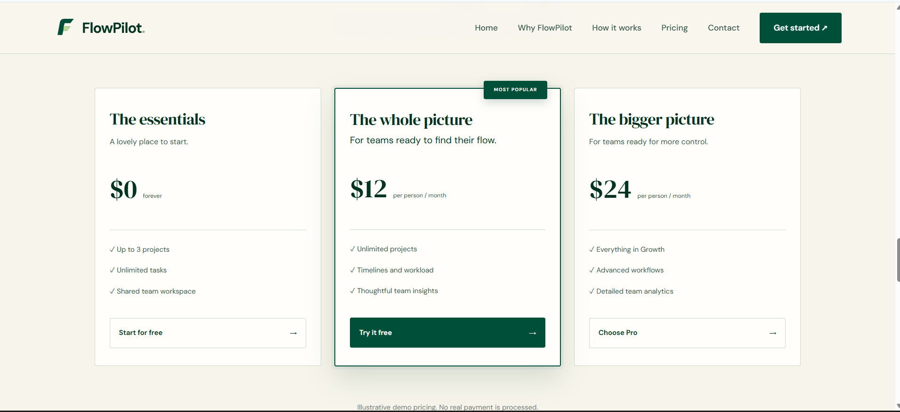

# 🚀 FlowPilot

### Plan Smarter. Work Better. Achieve More.

**FlowPilot** is a modern project management and workflow automation website designed to help individuals and teams organize projects, manage tasks, improve collaboration, and work more efficiently.

<p align="center">
  <a href="https://ghoshsoubhik622-rgb.github.io/FlowPilot/">
    <strong>🌐 VISIT LIVE WEBSITE</strong>
  </a>
</p>

---

## 🌐 Live Demo

**Website:** https://ghoshsoubhik622-rgb.github.io/FlowPilot/

**Repository:** https://github.com/ghoshsoubhik622-rgb/FlowPilot

## 📸 Website Preview

### 🏠 Homepage


### 💳 Pricing Section



### 📱 Mobile App Demo


---

## ✨ Features

- **Project Management:** Organize projects and manage tasks efficiently.
- **Smart Automation:** Simplify repetitive workflow activities.
- **Team Collaboration:** Improve communication and teamwork.
- **Responsive Design:** Designed for desktop, tablet and mobile screens.
- **Modern User Interface:** Clean, professional and user-friendly design.
- **Multiple Pricing Plans:** Starter, Growth and Pro packages.
- **Interactive Elements:** Forms, navigation, modals and interactive buttons.

## 🛠️ Technologies Used

| Technology | Purpose |
|---|---|
| HTML5 | Website structure |
| CSS3 | Styling, layout and animations |
| JavaScript | Interactivity and functionality |
| Google Fonts | Typography |
| GitHub | Version control and repository hosting |
| GitHub Pages | Website deployment |

## 📁 Project Structure

```text
FlowPilot/
│
├── index.html
├── styles.css
├── script.js
├── README.md
│
├── Screenshot 2026-11-14 232207.png
├── flowpilot-pricing.png.png
└── Mobile App demo.jpj.jpeg
```

## 💻 Run Locally

Follow these steps to run FlowPilot on your computer.

**1. Clone the repository**

```bash
git clone https://github.com/ghoshsoubhik622-rgb/FlowPilot.git
```

**2. Open the project folder**

```bash
cd FlowPilot
```

**3. Open in Visual Studio Code**

```bash
code .
```

**4. Run the website**

Open `index.html` using the Live Server extension in Visual Studio Code.

## 🚀 Deployment

FlowPilot is deployed using **GitHub Pages**.

Every committed update to the configured `main` branch is published through the GitHub Pages deployment workflow.

**Live Website:** https://ghoshsoubhik622-rgb.github.io/FlowPilot/

## 👨‍💻 Developer

**Soubhik Ghosh**

B.Tech – Computer Science and Engineering  
Specialization: Artificial Intelligence & Machine Learning

GitHub: [@ghoshsoubhik622-rgb](https://github.com/ghoshsoubhik622-rgb)

---

<p align="center">
  <strong>FlowPilot — Plan Smarter. Work Better. Achieve More.</strong>
</p>
